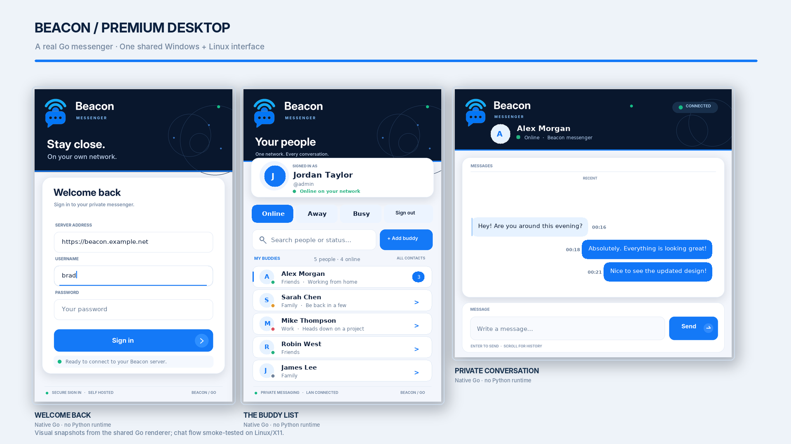

# Beacon

**Your people. Your network.** Beacon is a LAN-first, self-hosted instant messenger inspired by classic AOL Instant Messenger: compact buddy list, profile photos, online/away/busy status, sign-on notices, typing indicators and separate conversation windows. **Beacon is independent of Monita.**

## Current server development release: 0.9.1 — Account creation hotfix + native GitHub updater

**Windows and Linux use a shared Go/Fyne source code**, built as native executables. Users do **not** need Python, pip, a Go SDK, or to install Fyne in order to run a successfully built desktop client. The legacy Python/Tkinter prototype is retained temporarily under `clients/desktop/` for reference **only**; it is not the default client, not the release build and not required on user machines.

**Android remains a native Java/Android application**, which installs as an APK. The shared messaging **server remains Python/FastAPI in one Docker container** and supports ordinary Docker Engine, Docker Compose and container management interfaces. Converting the server to Go is outside this client migration.

| Platform | Primary implementation | Distribution target |
| --- | --- | --- |
| Windows | **Go 1.23+ / Fyne 2.8.1** | `Beacon-Windows-0.8.0.exe` |
| Linux | **Same Go/Fyne code** | `Beacon-Linux-0.8.0.tar.gz` including binary and desktop entry |
| Android | Native Android Java | Android 0.7.x debug APK workflow |
| Web | HTML/CSS/JavaScript | Served by the Docker server |
| Server | Python/FastAPI/SQLite | **Docker/Compose with native GitHub code updates** |

The Go desktop code includes authenticated sign-in, independent device sessions, secure *optional* saved login through OS credential vaults, buddy groups and aliases, presence, contact avatars, pop-out individual conversations, unread counts, typing indicators, sign-on/message notifications, buddy management, profile/photo/password changes, device revocation and message-history search. Fyne provides platform-native-style widgets, multiple windows and system tray support.

**Verification:** Source code and local build scripts are committed. GitHub Actions workflows were removed at the owner's direction. Compiled Windows/Linux executables are **not considered available or validated unless their actual workflows successfully run and the binaries pass target-platform testing**. Earlier Earlier GitHub Actions runs failed before allocation; all workflows were subsequently deleted. Linux binaries may depend on typical system graphics/X11/OpenGL libraries provided by the operating system; no Python runtime is required.

## Deploy the Docker server

Beacon runs in a **single ordinary Docker container**. Docker Engine,
Docker Compose, Portainer, Dokploy and other compatible Compose managers
are all supported. A public GitHub source build is enough for first install;
no registry image or platform API key is necessary.

For a fresh installation, use this example Compose configuration:

```yaml
services:
  beacon:
    build: "https://github.com/gigabytegrove/beacon.git#main"
    restart: unless-stopped
    ports:
      - "8765:8765"
    volumes:
      - beacon-data:/data
volumes:
  beacon-data:
```

Start Beacon using your preferred Docker management tool, open port 8765,
and view the container logs for the one-time administrator **SETUP CODE**.
Use that code in the browser's first-run wizard. The password and setup code
are not hard-coded. Keep your actual named volume stable: existing Compose
projects may use a project-prefixed volume name.

**Existing installations:** Do not overwrite a working volume mapping
with the example above. Confirm which volume currently holds
`/data/beacon.db`, and preserve it through upgrades.

The first move to version 0.9.0 requires one image build to install the
native supervisor. Once installed, subsequent compatible code updates
are initiated using Beacon's own **Control Center → Updates** without
managing Docker again.

Full setup and backups: [Install guide](docs/INSTALL.md).
Optional platform-specific Compose instructions:
[Dokploy](docs/DOKPLOY.md).

## Documentation

- [**Go desktop application — Windows and Linux**](clients/desktop-go/README.md)
- [Build and test clients when GitHub runners are unavailable](docs/BUILD-AND-TEST.md)
- [Platform build and packaging instructions](docs/PLATFORM-BUILDS.md)
- [Native-client parity and limits](docs/CLIENT-PARITY.md)
- [Android client](clients/android/README.md)
- [Dokploy deployment, upgrades and volumes](docs/DOKPLOY.md)
- [Standalone server installation and backups](docs/INSTALL.md)
- [API and WebSocket protocol](docs/API.md)
- [Architecture](docs/ARCHITECTURE.md)
- [Security](docs/SECURITY.md)
- [Troubleshooting](docs/TROUBLESHOOTING.md)
- [Development and testing](docs/DEVELOPMENT.md)
- [Release checklist](docs/RELEASE-CHECKLIST.md)
- [Changelog](CHANGELOG.md)
- [Legacy Python prototype (deprecated)](clients/desktop/README.md)

## Security and roadmap

Bearer tokens are user/device-specific, expire and can be revoked. Go clients **optionally** save them in Windows Credential Manager or a Linux Secret Service provider; when the secure vault is unavailable, login remains in memory only. The server stores messages in SQLite, **not end-to-end encrypted**. Plain HTTP is suitable only for a trusted LAN; HTTPS/WSS is recommended for untrusted network paths.

Real-time WebSocket push is currently implemented by the browser client; Go desktops poll at intervals for messaging and presence. Future areas: complete build/device verification, richer desktop notifications, guaranteed reconnect behavior, Android background delivery refinements, and eventual WebRTC audio/video. No unrelated Monita functionality will be added.

No license has been granted for this private repository; the owner retains rights.

## Hands-on testing and manual client builds

GitHub Actions has been deliberately disabled. The project includes Windows/Android PowerShell and Linux Bash builders under `scripts/`. The compiled GUI binaries must be produced on build workstations with Go/Fyne build prerequisites installed, **not** on ordinary user computers.

A separate dependency-free Go **Beacon Probe** is available for preflight testing of server health and authenticated APIs; it is **not** a graphical messenger. See [Build and Test](docs/BUILD-AND-TEST.md) and [Probe](tools/beacon-probe/README.md). Actual EXE/APK GUI downloads should not be claimed until built and tested.

## Desktop and server stabilization (October 11, 2026)

A coordinated reliability pass targets early Windows/Linux/Android testing without changing the deployment architecture:

- Server SQLite connections now close after each unit of work and roll back cleanly on failures.
- Buddy and directory presence are resolved with a small number of batch queries rather than one database connection per contact.
- Go desktop roster refreshes preserve scroll state when the roster has not changed, and a revoked/expired device token returns the client to the login screen instead of endlessly retrying.
- Added targeted regression tests for connection scope, transaction rollback, multi-device presence, roster account isolation and batch-query behavior.

**Test confidence:** These changes are source-level and have automated tests committed, but GitHub-hosted Actions continues to fail before assigning runners. Keep the client packages and server release labeled *unverified* until the actual builds and tests execute.

For runner-startup troubleshooting, see the [GitHub Actions recovery guide](docs/GITHUB-ACTIONS-RUNNER-RECOVERY.md).

## Build runner recovery — no checks bypassed

The Windows, Linux, Android and Python/Docker workflows now support **both** GitHub-hosted runners and trusted labeled self-hosted runners. Run **all four real test/build workflows** on properly provisioned machines, with the same checksum and artifact checks. Set `BEACON_USE_SELF_HOSTED_RUNNERS=true` as a GitHub Actions repository variable after registering the two isolated workers, or choose `self-hosted` under each manual workflow run. This does not mark an unbuilt client complete.

The full prerequisites, GitHub registration steps, security warnings, runner labels, and verification criteria are in [Self-hosted Build Runners](docs/SELF-HOSTED-BUILD-RUNNERS.md). The default remains GitHub-hosted when the variable is unset.


## Multi-device event delivery and read receipts

The Go desktop now uses authenticated **message-event cursors** in addition to the AIM buddy list's presence/unread refresh. Messages are caught up in ID order after temporary disconnects, and notifications no longer depend solely on unread counters increasing. The implementation validates server cursor continuity, rejects duplicate events and bounds each catch-up cycle. The Windows/Linux chat and native Android foreground Activity now send read receipts **after messages are rendered**, instead of marking background fetches as read.

The new Go event transport and tests have passed the local `go test -race` suite; this does **not** mean native GUI or APK binaries have been compiled. See the detailed [multi-device delivery and read-state guide](docs/MULTI-DEVICE-DELIVERY.md) and [build readiness](docs/BUILD-AND-TEST.md).


## Premium interface preview — Windows, Linux and Android design

A **locally built, branded Go/Win32 and Go/X11 visual preview** is now preserved under [`clients/desktop-native-preview`](clients/desktop-native-preview/BUILDING.md). It uses the supplied Beacon blue chat/wireless logo and includes the redesigned login screen, buddy list, separate private IM windows, profile/presence context, search/filter, native field focus/hover and readable error states.



**Actual compiled test builds** are checked in under [`releases/previews/2026-10-11/`](releases/previews/2026-10-11/README.md) with SHA256 checksums. Windows is delivered as a ZIP containing an EXE; Linux as a tar.gz. The Linux GUI was exercised against a simulated API; Windows was cross-compiled and PE-format checked, **not run on Windows**. These are **feature-incomplete previews** and must not replace the existing Go/Fyne desktop feature baseline until parity is proven.

The matching [Android premium resource kit](design/android-premium/README-PREMIUM.md) contains native Android XML styles/layouts, **not an APK**. The existing Android Java application remains unchanged until the resources are properly integrated and compiled.

See [Premium UI preview details](docs/PREMIUM-PREVIEW.md).


## Premium visual system now integrated into the supported clients

The approved navy/blue/white Beacon design is now integrated in the **primary Windows/Linux Go/Fyne application**, not only its separate Win32/X11 screenshots. The full-featured client now has the branded theme and logo, designed sign-in card, friendly network errors, securely optional remembered sign-in, searchable buddy roster, grouped contact cards with real presence states, empty states and individual message cards. Its device, group, profile, status, typing and message features were not removed.

Android's previously separate premium UI design kit is now installed in the **actual native Android app module** and used by MainActivity: branded header, lighter sign-in and roster styling, flat fields/buttons, contact rows and distinct incoming/outgoing message bubbles. The manifest selects BeaconTheme. Android source advances to v0.8.0.

Both Windows/Linux premium preview binaries remain available under releases/previews as UI references and runnable *limited* test clients, never as substitutes for the full Go/Fyne client. Source integration does not mean Fyne and Android Gradle have compiled: full supported GUI binaries and an APK remain mandatory release gates.

## Current build rule: local-only, no GitHub Actions

As instructed, Beacon's GitHub Actions workflow files have been **deleted**. The approved build process is to compile and verify Windows, Linux, Android and Docker/server artifacts locally, then use GitHub only for source control and publishing verified outputs. The [local-only build policy](docs/LOCAL-ONLY-BUILD-POLICY.md) overrides earlier workflow/runner setup references throughout historical documentation.

## October 12 local test builds

The [Windows and Linux locally compiled test builds](releases/previews/2026-10-12/README.md) are available with hashes, source and completed Go/Linux mock-server tests. They improve login reliability, missed-message notifications, and revoked-session behavior. They are native Go preview applications rather than the full Go/Fyne client and **do not include an Android APK**. GitHub Actions remains completely removed.


## First-run administration (server 0.8.2)

For an empty `beacon-data` database, Beacon **does not require a preconfigured password**. The server logs a cryptographically random one-time setup code to its private container logs. The web page detects an unclaimed installation and guides you through creating your own admin username and password. Setup is disabled forever after any user exists; redeploying never resets established accounts. The code is deleted after a successful claim. Existing explicitly configured environment-admin passwords are still honored on brand-new databases only.

**Important deployment prerequisite:** The supplied `compose.dokploy.yaml` must be used with a Git-sourced Dokploy Compose service. Pasting it into a *Raw Compose* editor produces `Dockerfile: no such file or directory` because raw mode does not check out the repository. See [the corrected Dokploy guide](docs/DOKPLOY.md).

## Built-in GitHub updater (server 0.9.0)

After one installation of the 0.9.0 image containing Beacon's native
supervisor, administrators use **Control Center → Updates**:

1. **Check GitHub** compares the running revision with public
   `gigabytegrove/beacon` `main`.
2. **Download & install** fetches source from GitHub, verifies files
   against immutable Git blob hashes, stores the new code on the
   existing `/data` volume, and restarts Beacon's application process.
3. **Roll back** returns to the prior code. Failed startup automatically
   reverts the application to the previous healthy version.

The updater does **not** contact Docker, Dokploy, Portainer, a sidecar,
GitHub Actions, an external registry or any deployment provider. Any
Docker environment can host it. Data remains on the persistent volume.

Changes to `requirements.txt`, the Python base image or the bootstrapping
supervisor still require rebuilding the Docker image, because those parts
are immutable and cannot be updated safely as ordinary application code.
The updater detects changed Python dependencies and refuses that install.

**Existing users need one initial image rebuild** to install the native
supervisor; if the current Compose already references GitHub `main`,
the existing deployment can be rebuilt without editing its Compose file.
After that, compatible application-code updates are performed entirely
inside Beacon.

[Architecture, security, supported updates and release gates](docs/SERVER-UPDATER.md).
